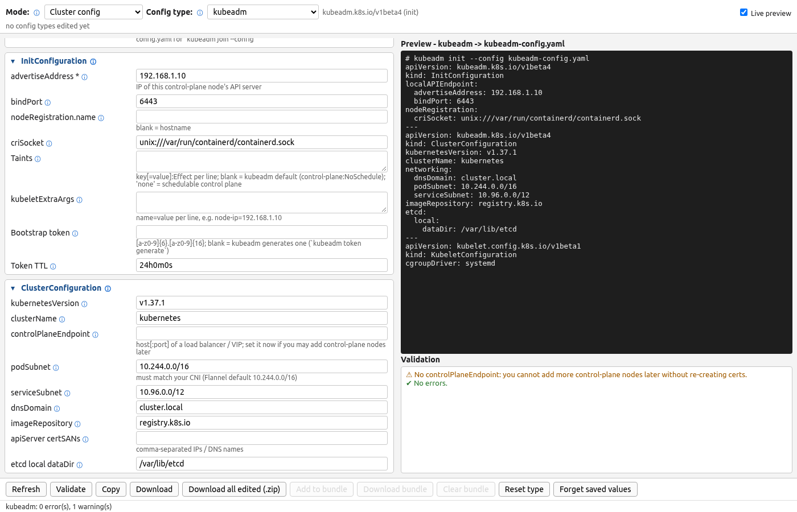

# Cluster config mode



Switch **Mode → Cluster config**, then choose a **Config type**. The dropdown is grouped
(`<optgroup>` labels):

| Group | Types |
|---|---|
| **Local** | kind, minikube, k3s / RKE2, k0s, MicroK8s |
| **Self-managed** | kubeadm, Talos, Kubespray, Cluster API, OpenShift |
| **Managed cloud** | EKS, GKE, AKS |
| **Access** | kubeconfig |

Each type gets its own form; the same Preview / Validation panes and **Validate / Copy /
Download / Download all edited (.zip) / Reset** buttons work as in Manifests mode, and values are
cached per type (switching modes returns you to the last type/kind you used in that mode).
Bundles are for manifests only, so those buttons are disabled here. Some types produce
**several files** (minikube, Kubespray, Talos, k0s "both"): the preview shows each under a
`# ===== name =====` banner and Download gives a `<type>.zip` with all of them (including
sub-folders such as `group_vars/k8s_cluster/`). Scripts are stored **0755**; files that carry credentials
(kubeconfig, k3s/RKE2 config, kubeadm config with a bootstrap token, OpenShift
install-config with the pull secret, MicroK8s launch config with a cluster token) are stored
**0600**. Download all edited (.zip) has one file per edited type, multi-file types into their own
sub-folder (`minikube/`, `kubespray/`, `talos/`) - no `all-in-one.yaml`.

## Platforms and how each was validated

Everything below was validated **offline** on Linux - no cloud credentials were used and no
cloud resources were created. "Real boot" means the generated file actually started a cluster,
which was then deleted.

| Platform | Output | Validated with | Depth |
|---|---|---|---|
| **minikube** | `config.json` (persistent `~/.minikube/config/config.json` keys, all string values) and/or `start-minikube.sh` (`minikube start` flags; extra args pass through, e.g. `--dry-run`) - pick via the *Generate* dropdown | minikube v1.39.0: every flag checked against `minikube start --help` + `minikube options`; every config key against `minikube config --help`; drivers against `minikube config defaults driver`; addons against `minikube addons list`; `minikube config set` round-trip reproduces our config.json byte-for-byte; `minikube start --dry-run` from config.json and from the script; **real boot** from the script (docker driver, containerd, metrics-server) → node Ready, profile cpus/memory match, then `minikube delete` | full + real boot |
| **k0s** | `k0sctl.yaml` (`k0sctl.k0sproject.io/v1beta1` Cluster with hosts/SSH) and/or `k0s.yaml` (`k0s.k0sproject.io/v1beta1` ClusterConfig) | `k0s config validate --config` (k0s v1.36.4+k0s.1) on k0s.yaml and on the config embedded in k0sctl.yaml | schema (k0sctl apply needs SSH hosts) |
| **MicroK8s** | `microk8s-config.yaml` launch configuration (v0.1.0 / v0.2.0) for `/var/snap/microk8s/common/.microk8s.yaml` or `snap set microk8s config=` | Generator tests (`tests/test_cluster_platforms.py`): keys follow canonical/microk8s-cluster-agent `pkg/k8sinit/schema.go`; the default and a full v0.2.0 config are parsed and their keys checked, and negative cases (bad version, short cluster token, malformed `--flag` args) must be rejected | generator tests only (no upstream parser) |
| **k3s / RKE2** | `config.yaml` | `k3s`/`rke2 --help` (v1.37.1); k3s **real boot** in docker | full + real boot |
| **kind** | `kind-config.yaml` | `kind create cluster` (real boot) | real boot |
| **kubeadm** | `kubeadm-config.yaml` | `kubeadm config validate` (v1.37.1) | full |
| **Talos** | `talos-gen-config.sh` (`talosctl gen config <name> <endpoint>` + flags, then `talosctl validate --strict` on the results) + `talos-patch.yaml` / `talos-patch-controlplane.yaml` / `talos-patch-worker.yaml` in the **Talos 1.14 multi-document** format (KubeNetworkConfig, KubeFlannelCNIConfig, KubeProxyConfig, ResolverConfig, TimeSyncConfig, KubeNodeConfig, KubeletConfig) | talosctl v1.14.4: the script is run, the patches applied by `gen config`, both machine configs pass `validate --mode metal --strict` (this caught that KubeProxyConfig is control-plane-only) | full |
| **Kubespray** | `inventory.ini` + `group_vars/all/all.yml` + `group_vars/k8s_cluster/k8s-cluster.yml` + `group_vars/k8s_cluster/addons.yml` - copy into `kubespray/inventory/<name>/` | `ansible-inventory --list` (ansible-core 2.21) + kubespray **v2.32.0's own `validate_inventory` role** (assert-only, no SSH) + every variable name checked to exist in the 2.32.0 tree; kube_version checked against its checksums (1.34.0-1.36.4) | full (no hosts contacted) |
| **Cluster API** | `capi-<name>.yaml`: v1beta2 `Cluster`, `DockerCluster`, `KubeadmControlPlane`, 2 × `DockerMachineTemplate`, `MachineDeployment`, `KubeadmConfigTemplate` (CAPD) | CAPI v1.14.3 + CAPD CRDs installed in a temporary kind cluster, `kubectl apply --dry-run=server` (7/7 objects accepted; a ref without apiGroup is rejected), cluster deleted | server-side schema |
| **OpenShift** | `install-config.yaml` (v1) - platform none / aws / azure / gcp / vsphere / baremetal | openshift-install 4.22.18: `create manifests` for platform **none** (3-node and single-node); all six platforms validated against the installer's InstallConfig CRD schema | none: installer; clouds/vsphere/baremetal: schema only |
| **EKS** | `eksctl-<name>.yaml` - `eksctl.io/v1alpha5` ClusterConfig with managedNodeGroups (instanceType or instanceTypes for spot), VPC/NAT, endpoints, IPv4/IPv6, Auto Mode, add-ons, CloudWatch logging, access entries auth mode | eksctl 0.231.0: JSON Schema from `eksctl utils schema` (additionalProperties=false, so typos fail) | schema only (`eksctl create cluster --dry-run` needs AWS STS credentials) |
| **GKE** | `create-gke-<name>.sh` - `gcloud container clusters create` (Standard) or `create-auto` (Autopilot). **Chosen over Config Connector YAML** because it needs no management cluster with Config Connector installed | Google Cloud SDK 590.0.0: every flag exists in `gcloud container clusters create[-auto] --help` (+ gcloud-wide flags) and enum values (release channel, disk type, add-ons) are among the documented choices; `bash -n` | help-text only |
| **AKS** | `create-aks-<name>.sh` - optional `az group create` + `az aks create`. **Chosen over Bicep/ARM** (it's what the AKS docs use; no template toolchain) | azure-cli 2.91.0: every flag exists in `az aks create --help`, enum values among "Allowed values"; never uses `--generate-ssh-keys` (it writes `~/.ssh/id_rsa`) - `--ssh-key-value` or `--no-ssh-key`; `bash -n` | help-text only |
| **kubeconfig** | `<cluster>.kubeconfig` | `kubectl config view/get-contexts` + live `kubectl get nodes` | full |

Platform validation highlights: minikube cpus ≥ 2 / memory ≥ 1800 MB / disk ≥ 2000 MB,
`--ha` needs ≥ 3 nodes, driver `none` is single-node, docker/podman-only flags (`--ports`,
`--listen-address`, `--static-ip`, `--subnet`, cpus `no-limit`), unknown addons with a
"did you mean"; k0s controller counts / duplicate addresses / version format; Talos
endpoint must be `https://host:port`, overlapping subnets, taint syntax; Kubespray odd etcd
count, empty control plane, unsupported kube_version, pod subnet too small for the node
count, MetalLB needing `kube_proxy_strict_arp` with ipvs; CAPI odd control-plane replicas
and restricted node labels; OpenShift SNO rules, hostPrefix sizing, OVN-reserved
100.64.0.0/16 and 100.88.0.0/16, VIPs inside machineNetwork, pull-secret JSON shape,
public-only SSH keys; EKS min ≤ desired ≤ max, AZs in region, private node groups need NAT,
IPv6 needs OIDC; GKE name rules, Autopilot must be regional, private-cluster /28 master
range, Calico NetworkPolicy add-on vs Dataplane V2; AKS overlay/Cilium/policy combinations,
dns-service-ip inside service-cidr, workload identity needs OIDC, Azure RBAC needs Entra ID,
private cluster vs authorized IP ranges.

The original four types in detail:

| Type | Output (default filename) | What you can set | Validated with (real tool) |
|---|---|---|---|
| **kubeadm** | `kubeadm-config.yaml` (*init*: `InitConfiguration` + `ClusterConfiguration` [+ `KubeletConfiguration`] [+ `KubeProxyConfiguration`]) or `kubeadm-join-config.yaml` (*join*: `JoinConfiguration`) - API **`kubeadm.k8s.io/v1beta4`** | advertiseAddress, bindPort, nodeRegistration name / criSocket (containerd / CRI-O / cri-dockerd) / taints (`none` = schedulable control plane) / kubeletExtraArgs, bootstrap token + TTL; kubernetesVersion, clusterName, controlPlaneEndpoint, pod/service subnets, dnsDomain, imageRepository, apiServer certSANs, etcd dataDir; kubelet cgroupDriver; kube-proxy mode iptables/ipvs/nftables; join endpoint, token, caCertHashes or unsafeSkipCAVerification, control-plane join + certificateKey | `kubeadm config print init-defaults` (format reference) and `kubeadm config validate --config` (kubeadm v1.37.1) |
| **kind** | `kind-config.yaml` - `kind.x-k8s.io/v1alpha4` `Cluster` | name, nodes table (role, **count**, image, labels), extraPortMappings (on the first control-plane), networking ipFamily / apiServerAddress / apiServerPort / podSubnet / serviceSubnet / disableDefaultCNI / kubeProxyMode, featureGates | `kind create cluster --config` (kind v0.34), then `kind delete cluster` |
| **kubeconfig** | `<cluster>.kubeconfig` (rename to `~/.kube/config` or use `KUBECONFIG=`) | cluster name + server, CA as **file path, pasted PEM (base64-encoded for you) or base64** / insecure-skip-tls-verify / system CAs, tls-server-name, proxy-url; user auth **token / client certificate + key / username-password / exec plugin** (apiVersion, command, args, env, interactiveMode, provideClusterInfo); context name, namespace, current-context | `kubectl config view --kubeconfig` and `kubectl config get-contexts --kubeconfig`; plus a live `kubectl get nodes` against a kind cluster using a generated kubeconfig |
| **k3s / RKE2** | `config.yaml` - header says where it goes: `/etc/rancher/k3s/config.yaml` or `/etc/rancher/rke2/config.yaml` | distro, role server/agent, cluster-init (k3s HA embedded etcd), token, server URL (k3s :6443, RKE2 :9345), node-name, node-ip, node-external-ip, tls-san, cluster-cidr, service-cidr, cluster-dns, cluster-domain, **flannel-backend** (k3s) / **cni** + multus (RKE2), ingress-controller (RKE2), **disable** components (checkboxes per distro), node-label, node-taint, write-kubeconfig-mode | every key and dropdown value checked against `k3s server\|agent --help` (v1.37.1+k3s1) and `rke2 server\|agent --help` (v1.37.1+rke2r1); a generated k3s server config also booted in `rancher/k3s` docker → node Ready |

Validation catches the usual mistakes before a tool does: bad IPs/ports, CIDRs with host
bits set (with a "did you mean 10.244.0.0/16?" hint), overlapping pod/service ranges,
bootstrap token / TTL / caCertHash / certificateKey formats, cluster-dns outside
service-cidr, ipFamily vs subnet mismatches, kind configs without a control-plane, even
control-plane counts (warning), duplicate host ports, server-only k3s/RKE2 options on an
agent, an RKE2 join URL on :6443 (warning), damaged pasted PEM, `~` in kubeconfig paths,
world-readable write-kubeconfig-mode, deprecated ipvs (warning, since 1.35), etc.

From code (no GUI dependency):

```python
import cluster_config_gen as ccg
vals = {**ccg.defaults("kind"), "name": "lab", "kube_proxy_mode": "nftables"}
res = ccg.generate("kind", vals)          # ConfigResult(docs, errors, warnings, filename, header, info, files)
if res.ok:
    for f in ccg.outputs(res):            # OutFile(name, text, mode) - several for minikube / Kubespray / Talos
        open(f.name, "w").write(f.text)
print(ccg.GROUPS)                         # {"Local": [...], "Self-managed": [...], ...}
```

The platform types live in `clusterplatforms/` (one module each: `TYPE`, `GROUP`, `SCHEMA`,
`build(ctx)`, optional `check_row`), registered by `cluster_config_gen.py`.
