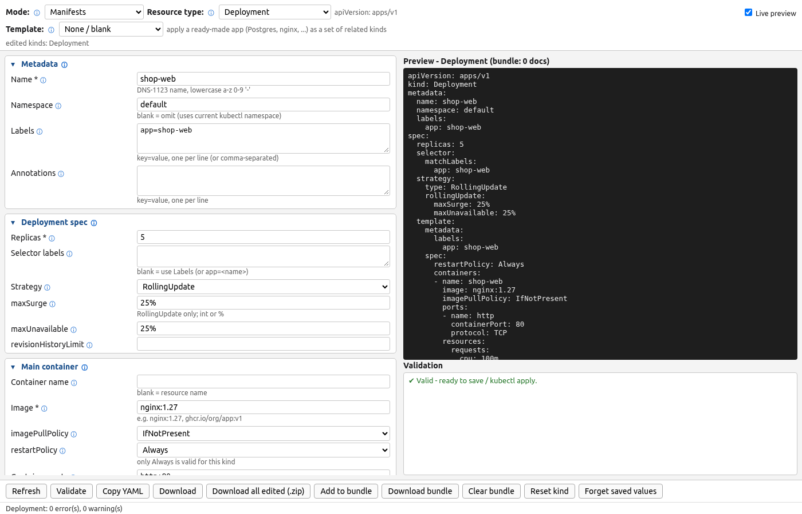

# Manifests mode

## Overview

The **Mode** selector at the top of the page switches between three modes:

- **Manifests** - Kubernetes resources (below)
- **Cluster config** - files for *creating / connecting to* a cluster: **kubeadm**,
  **kind**, **kubeconfig**, **k3s / RKE2** `config.yaml` and more platforms (see
  [Cluster config mode](cluster-config.md))
- **Networking & Storage** - CNI add-ons (Calico, Cilium, Flannel, Canal, Antrea, Multus) and CSI
  StorageClasses for 15 drivers, with install scripts (see [Networking & Storage mode](networking-storage.md))

In Manifests mode pick a kind from the **Resource type** dropdown, or start from one of
25 **application templates** (PostgreSQL, MySQL, MongoDB, Redis, Kafka, nginx, WordPress, ...)
that fill several kinds at once (see [Application templates](templates.md)):

**Deployment · StatefulSet · DaemonSet · Job · CronJob · Service · Ingress ·
ConfigMap · Secret · PersistentVolumeClaim · Namespace · NetworkPolicy · StorageClass ·
VolumeSnapshotClass**

Only the selected kind's form is shown; the YAML preview and Validation panes stay
on the right. Values you type are **kept per kind in your browser** (localStorage), so you can
switch to Service, fill it in, reload the page, and come back to your Deployment exactly as you
left it. The header shows which kinds you've edited. **Reset kind** puts the current kind back to
its defaults; **Forget saved values** clears everything. The server stores nothing.

More screenshots: [template applied](images/web-template.png) · [cluster config](images/web-cluster-config.png) · [tooltip](images/web-tooltip.png)

## Features

- Form fields for name, namespace, labels, annotations, image, replicas, container
  ports, env vars (incl. `@secret:` / `@configmap:` references), envFrom,
  CPU/memory requests & limits, probes, volumes/volumeMounts (PVC, ConfigMap,
  Secret, emptyDir, hostPath), command/args, serviceAccountName, nodeSelector,
  imagePullSecrets, and kind-specific fields (CronJob schedule/timeZone/concurrency,
  Job backoffLimit/completions/parallelism/TTL, StatefulSet serviceName +
  volumeClaimTemplate, Service type/selector/ports/targetPort/nodePort, Ingress
  host/path/pathType/backend/TLS/ingressClassName, ConfigMap & Secret data, PVC size…).
- Dropdowns for imagePullPolicy, restartPolicy (constrained per kind - Jobs/CronJobs
  only offer OnFailure/Never), Service type, Secret type, PVC access mode,
  storageClass (editable), protocol, update strategy, concurrencyPolicy, pathType,
  volumeMode, ingressClassName (editable).
- **Live YAML preview** (debounced 300 ms; toggle *Live preview* off and use **Refresh** /
  `Ctrl/Cmd+Enter` instead).
- **Validate** - DNS-1123/1035 names, label keys/values, required fields, numeric
  ranges, ports, quantities (`500m`, `1Gi`), cron syntax, request ≤ limit,
  Secret-type required keys, etc. Friendly messages in the Validation pane.
- **Copy YAML** to clipboard, **Download** saves `<kind-lower>-<name>.yaml` (or `<type>.zip`
  for multi-file outputs like minikube / Kubespray / Talos). **Download all edited (.zip)**
  holds one file for every kind you changed from its defaults, plus an `all-in-one.yaml`
  multi-doc and `SKIPPED.txt` listing invalid kinds. **Add to bundle / Download bundle /
  Clear bundle** builds a hand-picked multi-document `bundle.yaml` (e.g. two Deployments
  with different names).
- Secret values are typed as **plaintext and base64-encoded into `data:`**
  (tick *Values are already base64* to paste pre-encoded values). Helpers for
  `kubernetes.io/dockerconfigjson` (registry/user/password → `.dockerconfigjson`),
  TLS (`tls.crt`/`tls.key` multi-line fields), ssh-auth and service-account-token.
- **Multiple containers** (Deployment, StatefulSet, DaemonSet, Job, CronJob): the
  *Init & sidecar containers* section lists extra containers in a table with
  **Add / Edit / Duplicate / Remove / ▲ ▼**. Add and Edit open a modal editor dialog (name, image,
  imagePullPolicy, command/args, ports + protocol, env, CPU/memory, volumeMounts,
  workingDir) with a **Role** dropdown:
  - `sidecar (regular container)` - goes into `containers:` next to the main one
  - `sidecar (native)` - goes into `initContainers:` with `restartPolicy: Always`
    (starts before the app and keeps running; **Kubernetes 1.29+**, a warning reminds you)
  - `init` - a classic run-to-completion init container (list order = run order)
  - `main` - an additional app container
  The original *Main container* fields still define the primary container.
- **Scheduling**: nodeSelector, serviceAccountName etc. plus table editors for
  **Tolerations** (key, operator Equal/Exists, value, effect, tolerationSeconds),
  **Node affinity** (required/preferred, key, operator In/NotIn/Exists/DoesNotExist/Gt/Lt,
  values, weight, term #), **Pod affinity / anti-affinity** (required/preferred, label
  selector key/operator/values, topologyKey prefilled with `kubernetes.io/hostname`,
  `topology.kubernetes.io/zone`, `topology.kubernetes.io/region`, weight, namespaces) and
  **Topology spread** constraints (maxSkew, topologyKey, whenUnsatisfiable, match labels).
  The DaemonSet *Tolerate all taints* checkbox still works and combines with the table.
- Dropdowns: readonly ones are `<select>`, editable ones an input + `<datalist>`; grouped type
  and template lists use `<optgroup>`. Table rows are validated by the same `check_row` as the
  generator before they are accepted.
- The form is split into **collapsible sections** (`
`). Probes, containers and the
  advanced scheduling sections start collapsed; the open/closed state and all table rows are
  remembered per kind.
- Keyboard: **Ctrl/Cmd+K** focuses the type picker, **Ctrl/Cmd+S** downloads, **Ctrl/Cmd+Enter**
  refreshes the preview (and is OK in the row dialog). Reloading the page is harmless because
  values persist.
- All generation happens server-side in the headless core (`manifest_gen`, `cluster_config_gen`
  with `clusterplatforms/`, `addons_gen` with `addons/`, `app_templates`, `field_docs`, `providers`), which you can also use from
  scripts/CI - see [Using the generator from code](architecture.md#using-the-generator-from-code).

### File modes and other browser specifics

- Browsers can't set file modes. **Zip downloads store the Unix modes** (`unzip` / macOS Archive
  Utility restore 0600 for Secrets, kubeconfig, k3s/kubeadm/OpenShift/MicroK8s configs and 0755
  for scripts). For a single-file download run `chmod 600 <file>` (or `chmod +x` for a `.sh`)
  yourself; the response's `X-File-Mode` header and the status line say when.
- Files go to the browser's download location; nothing is written on the server.
- Saved values persist in localStorage until *Forget saved values*. Anyone using the same browser
  profile can see them, including Secret data and generated template passwords.
- Messages use `alert()` / `confirm()` and the status line.

## Field formats

| Field | Format | Example |
|---|---|---|
| Labels / selector / nodeSelector | `key=value`, one per line or comma-separated | `app=web, tier=frontend` |
| Annotations | `key=value`, one per line (values may contain commas) | `owner=john` |
| Container ports | `[name:]port[/PROTO]`, one per line | `http:8080`, `dns:53/UDP` |
| Env vars | `KEY=VALUE`; references `KEY=@secret:name/key`, `KEY=@configmap:name/key` | `DB_PASS=@secret:db/password` |
| envFrom | `configmap:name` or `secret:name` | `configmap:app-config` |
| Command / Args | one line → shell-split; multiple lines → one argument per line | `sh -c 'echo hi'` |
| Volumes | `name:type:source:mountPath[:ro]` - types `pvc`, `configMap`, `secret`, `emptyDir` (source blank, `Memory` or a sizeLimit), `hostPath`. mountPath is where the **main** container mounts it; leave it blank to only define the volume for sidecars | `data:pvc:my-claim:/data`, `logs:emptyDir::` |
| Service additional ports | `name:port:targetPort[:nodePort][/PROTO]` | `metrics:9113:9113` |
| Ingress additional paths | `host path pathType service port` (`-` = main host) | `- /api Prefix api 8080` |
| Extra container volumeMounts | `volume:/mount/path[:ro]` per line; the volume must exist in *Volumes* (or be the StatefulSet volumeClaimTemplate) | `logs:/var/log/app:ro` |
| Affinity / toleration values | comma-separated | `us-west-2a, us-west-2b` |
| ConfigMap / Secret data | `KEY=VALUE` per line (`\n` → newline) + optional multi-line *File key/content* | `LOG_LEVEL=info` |
