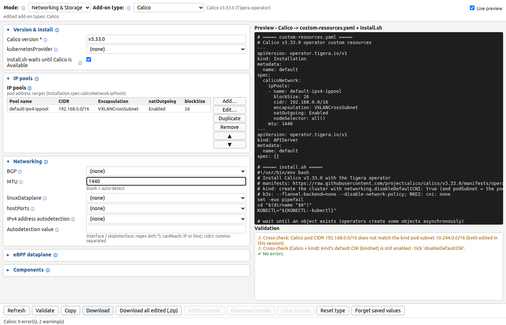
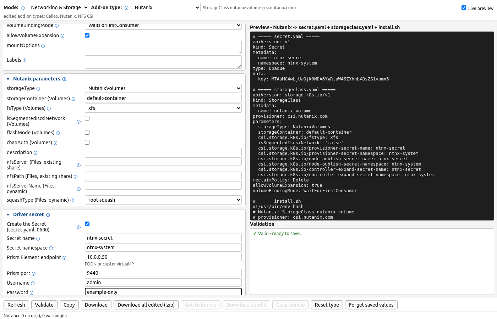

# Networking & Storage mode

The third **Mode**, *Networking & Storage*, builds **CNI** and **CSI** add-on configuration. The
**Add-on type** dropdown is grouped like the cluster-config one:

| Group | Types | Output files |
|---|---|---|
| CNI | **Calico** (Tigera operator `Installation` + `APIServer` CRs), **Cilium** (Helm), **Flannel**, **Canal**, **Antrea**, **Multus** (+ NetworkAttachmentDefinitions) | CRs / Helm `values.yaml` / ConfigMap patches + `install.sh` |
| CSI - cloud | **AWS EBS**, **AWS EFS**, **GCE PD**, **Azure Disk**, **Azure File** | `storageclass.yaml` (+ `volumesnapshotclass.yaml`, `values.yaml`, `install.sh`) |
| CSI - on-prem | **vSphere**, **Nutanix**, **NFS CSI**, **SMB CSI** | as above + driver `secret.yaml` (0600) for Nutanix / SMB, optional demo `nfs-server.yaml` |
| CSI - in-cluster | **Longhorn**, **Rook-Ceph RBD**, **Rook-Ceph CephFS**, **OpenEBS LocalPV** (hostpath), **TopoLVM**, **local-path** | as above (+ `ceph-pool.yaml` for Rook) |

**CNI forms** (every field has an ⓘ tooltip naming the YAML key it sets):

- **Calico** - version, kubernetesProvider, an **IP pools** table (name, CIDR, encapsulation
  `VXLAN / IPIP / VXLANCrossSubnet / IPIPCrossSubnet / None`, natOutgoing, blockSize, nodeSelector),
  BGP, MTU, linuxDataplane (`Iptables / Nftables / BPF`), eBPF options (kubeProxyManagement,
  API-server endpoint ConfigMap), hostPorts, IP autodetection. `install.sh` applies the pinned
  `tigera-operator.yaml` and waits for `tigerastatus`.
- **Cilium** - chart version, IPAM mode `cluster-pool / kubernetes / eni / azure` and
  `clusterPoolIPv4PodCIDRList`, kubeProxyReplacement (+ API server host/port), routingMode
  `tunnel / native` (+ `ipv4NativeRoutingCIDR`), tunnelProtocol `vxlan / geneve`, Hubble (relay, UI),
  encryption `none / wireguard / ipsec`, BGP control plane, Gateway API (installs the pinned
  Gateway API CRDs first), L2 announcements, BPF masquerading, policy enforcement mode, operator
  replicas. `install.sh` uses `helm` or the `cilium` CLI.
- **Flannel** - `net-conf.json` (Network, Backend `vxlan / host-gw / wireguard / udp`, VNI, port,
  DirectRouting, WireGuard keepalive, EnableNFTables, IPv6 network, SubnetLen) written as the
  `kube-flannel-cfg` ConfigMap and applied over the pinned kube-flannel manifest.
- **Canal** - Calico policy + flannel networking: `canal-config` ConfigMap (pod network, backend,
  canal_iface, masquerade, MTU) over the pinned canal.yaml.
- **Antrea** - `antrea-agent.conf` / `antrea-controller.conf` keys (trafficEncapMode, tunnelType,
  trafficEncryptionMode, WireGuard port, noSNAT, transport interface, proxyAll, NodeIPAM cluster
  CIDRs, feature gates) as Helm `values.yaml` for the antrea chart.
- **Multus** - thin or thick DaemonSet + a **NetworkAttachmentDefinition** builder: plugin
  `macvlan / ipvlan / bridge / host-device`, master interface, mode, IPAM
  `host-local / whereabouts / static` (whereabouts is installed too when chosen).

**CSI forms** all share the StorageClass fields - name, *default class* annotation,
reclaimPolicy `Delete / Retain`, volumeBindingMode `Immediate / WaitForFirstConsumer`,
allowVolumeExpansion, mountOptions, labels, an **Allowed topologies** table and free-form
**Extra parameters** - plus a "*Type* parameters" section with the driver's own keys (checked
against each driver's docs), for example:

| Type | Provisioner | Parameters |
|---|---|---|
| AWS EBS | `ebs.csi.aws.com` | type `gp3/gp2/io1/io2/st1/sc1/standard`, iops, iopsPerGB, throughput, encrypted, kmsKeyId, fstype |
| AWS EFS | `efs.csi.aws.com` | provisioningMode `efs-ap`, fileSystemId, directoryPerms, uid/gid, gidRange, basePath, subPathPattern |
| GCE PD | `pd.csi.storage.gke.io` | type `pd-standard/pd-balanced/pd-ssd/pd-extreme/hyperdisk-*`, replication-type, provisioned IOPS/throughput, KMS key, labels |
| Azure Disk | `disk.csi.azure.com` | skuName, cachingMode, IOPS / MBps, networkAccessPolicy, diskEncryptionSetID, resourceGroup, tags |
| Azure File | `file.csi.azure.com` | skuName, protocol `smb/nfs`, shareName, storageAccount, networkEndpointType, enableLargeFileShares |
| vSphere | `csi.vsphere.vmware.com` | storagepolicyname, datastoreurl, fstype |
| Nutanix | `csi.nutanix.com` | storageType `NutanixVolumes/NutanixFiles`, storageContainer, isSegmentedIscsiNetwork, flashMode, chapAuth, NFS server/path, squashType, fsType + Prism secret refs |
| Longhorn | `driver.longhorn.io` | numberOfReplicas, staleReplicaTimeout, dataLocality, dataEngine, disk/node selectors |
| Rook-Ceph RBD / CephFS | `<operator ns>.rbd/cephfs.csi.ceph.com` | clusterID, pool, imageFormat, imageFeatures, fsName + CSI secret refs |
| OpenEBS LocalPV | `openebs.io/local` | BasePath (hostpath `cas.openebs.io/config`) |
| NFS CSI | `nfs.csi.k8s.io` | server, share, subDir, mountPermissions, onDelete, mountOptions (`nfsvers=4.1`) |
| SMB CSI | `smb.csi.k8s.io` | source, subDir, onDelete + credentials secret |
| local-path | `rancher.io/local-path` | nodePath, pathPattern, defaultVolumeType |
| TopoLVM | `topolvm.io` | device-class, fstype |

Optional companions: a **VolumeSnapshotClass** (deletionPolicy, default annotation, installs the
pinned external-snapshotter CRDs + controller), the **driver Secret** (base64, written 0600) and a
**driver install** (`values.yaml` + `install.sh` with pinned chart versions) for every driver
where that makes sense - Longhorn, NFS CSI (optionally with an in-cluster *demo* NFS server),
SMB CSI, local-path, OpenEBS, TopoLVM, a minimal Rook operator (+ `CephBlockPool` /
`CephFilesystem`), EBS / EFS (IRSA role ARN) and the Nutanix chart.

Pinned versions (all checked to exist): Calico v3.33.0, Cilium 1.20.3 (cilium-cli v0.20.1),
Flannel v0.28.10, Antrea 2.7.0, Multus v4.3.1, Whereabouts v0.9.4, Gateway API v1.6.3,
external-snapshotter v8.7.0, csi-driver-nfs 4.13.5, csi-driver-smb 1.20.3, local-path v0.0.37,
Longhorn 1.13.0, rook-ceph 1.21.0, OpenEBS localpv 4.6.0, aws-ebs-csi-driver chart 2.67.1,
aws-efs-csi-driver chart 4.5.2, nutanix-csi-storage 2.6.10, TopoLVM 17.3.0. Every `install.sh`
passes `$HELM_EXTRA_ARGS` to `helm` (registry mirrors, extra `--set` overrides).

**New manifest kinds.** Manifests mode also gained **NetworkPolicy** (podSelector, policyTypes,
**Ingress rules** / **Egress rules** tables with from/to podSelector, namespaceSelector, ipBlock
(+ except), ports and protocol, and the presets *default-deny-all*, *allow-same-namespace* and
*allow-DNS-egress*), **StorageClass** (generic, any provisioner) and **VolumeSnapshotClass**.

**Cross-checks (soft warnings).** When both forms were *edited in this session*, generating a CNI
add-on or a cluster config compares the CNI's pod CIDR with the cluster's pod subnet (kind
`podSubnet`, kubeadm `podSubnet`, k3s / RKE2 `cluster-cidr`, k0s, Talos, Kubespray, minikube,
EKS / AKS / GKE network options) and warns on a mismatch or when the platform's own CNI is still
enabled (kind without `disableDefaultCNI`, k3s without `flannel-backend: none`, RKE2 `cni` not
`none`, minikube `--cni`, AKS plugin, GKE-managed networking, EKS vpc-cni). Warnings start with
`Cross-check:`; they never block generation. **StorageClass names** you create in this session
(StorageClass kind or any CSI type) are offered in the PVC `storageClassName` and StatefulSet
volumeClaimTemplate storage-class dropdowns.

## Screenshots

More: [Cilium](images/web-addons-cilium.png) · [NetworkPolicy](images/web-networkpolicy.png)
