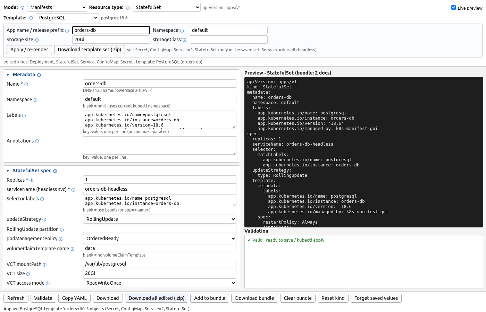

# Application templates

In Manifests mode the **Template:** dropdown (default *None / blank*) applies a ready-made
application as a **set of related kinds**, e.g. *PostgreSQL* fills the StatefulSet, Service,
Secret and ConfigMap forms in one go. Templates are grouped (Databases · Messaging ·
Web / proxy · Apps / tools) with `<optgroup>` labels.



What happens when you pick one:

- The set is rendered with sensible defaults and loaded into the per-kind forms. The
  selector switches to the **primary kind** (StatefulSet for databases, Deployment for web
  apps) and every kind the set touched shows up as *edited* (the header also names the
  template). From there it's ordinary forms: change anything you like.
- A **Template parameters** panel appears: *App name / release prefix* (every object is
  named after it: `db1`, `db1-headless`, `db1-secret`, ...), *Namespace* (anything other
  than `default` adds a Namespace object to the set), plus *Replicas* for scalable apps,
  *Storage size* / *storageClass* for apps with persistent data, and *Expose via Ingress* /
  *Ingress host* / *ingressClassName* for apps with a web UI. Changing a parameter
  **re-renders the whole set** automatically (0.6 s after the last change). Generated passwords stay the
  same across re-renders.
- **Overwrite protection**: if you've hand-edited a form the template would replace, the
  automatic re-render is held back and the panel says so; **Apply / re-render** then asks
  for confirmation (*No* keeps your edits). Switching to another template resets kinds that
  only the previous template filled and you didn't touch; hand-edited ones are kept.
  *None / blank* detaches the template and leaves the forms as they are (**Reset kind**
  clears a form).
- A set can hold more than one object of a kind (PostgreSQL has a ClusterIP **and** a
  headless Service; WordPress has a second StatefulSet for MySQL). The first object of each
  kind goes into that kind's form; the others are listed in the panel as *only in the
  saved set*.
- **Download template set (.zip)** holds every object of the set as its own file plus an
  `all-in-one.yaml` (in apply order: Namespace, Secret, ConfigMap, PVC, Service, workloads,
  Ingress) in a folder named after the app: `<app name>/`. Objects that are in the
  forms are taken **from the forms**, so your edits are included. Secret files and the
  all-in-one file carry mode `0600` in the zip.

Common conventions in every template: images are pinned to an exact stable tag
(verified against Docker Hub / quay.io in Oct 2026, never `latest`); labels are
`app.kubernetes.io/{name,instance,version,managed-by}` with the selector on
`name` + `instance` (+ `component` for WordPress's two tiers), so a version bump doesn't
change the immutable selector; every container has readiness **and** liveness probes
(exec / httpGet / tcpSocket as suits the app) and CPU/memory requests and limits; passwords
come from Python's `secrets` CSPRNG (24 letters and digits) and are stored base64-encoded in
a Secret that workloads read via `envFrom` / `secretKeyRef`; databases use a StatefulSet with a
volumeClaimTemplate, `serviceName: <name>-headless` and a separate ClusterIP Service `<name>`
for clients; Deployments that mount a ReadWriteOnce PVC use `strategy: Recreate`.

| Group | Template | Image | Objects (default parameters) | What you get |
|---|---|---|---|---|
| Databases | **PostgreSQL** | `postgres:18.6` | Secret + ConfigMap + 2× Service + StatefulSet | StatefulSet (PGDATA on a volumeClaimTemplate, pg_isready probes), ClusterIP + headless Service, Secret with a random password, ConfigMap with an init SQL script (runs on first start). |
| Databases | **MySQL** | `mysql:8.4.11` | Secret + ConfigMap + 2× Service + StatefulSet | StatefulSet (datadir on a volumeClaimTemplate, mysqladmin ping probes), ClusterIP + headless Service, Secret (root + app user passwords), ConfigMap with a my.cnf override. |
| Databases | **MariaDB** | `mariadb:11.8.9` | Secret + ConfigMap + 2× Service + StatefulSet | StatefulSet (healthcheck.sh probes), ClusterIP + headless Service, Secret, ConfigMap (my.cnf override). |
| Databases | **MongoDB** | `mongo:8.0.34` | Secret + 2× Service + StatefulSet | StatefulSet (/data/db on a volumeClaimTemplate, mongosh ping probes), ClusterIP + headless Service, Secret with the root user/password. |
| Databases | **Redis** | `redis:8.10.2` | Secret + 2× Service + StatefulSet | StatefulSet (AOF persistence on a volumeClaimTemplate, requirepass from the Secret, redis-cli ping probes), ClusterIP + headless Service, Secret. |
| Databases | **Valkey** | `valkey/valkey:9.1.2` | Secret + 2× Service + StatefulSet | Redis-compatible Valkey: StatefulSet (AOF, requirepass, valkey-cli ping probes), Services, Secret. |
| Databases | **Cassandra** | `cassandra:5.0.9` | 2× Service + StatefulSet | StatefulSet (seed = pod 0 via the headless Service, nodetool readiness), ClusterIP CQL Service, headless Service with publishNotReadyAddresses (gossip), small heap for test clusters. |
| Databases | **Elasticsearch** | `elasticsearch:9.5.5` | 2× Service + StatefulSet | Single-node StatefulSet (discovery.type=single-node, 512m heap, fsGroup 1000), HTTP health probes, ClusterIP + headless Service. |
| Databases | **OpenSearch** | `opensearchproject/opensearch:3.9.0` | 2× Service + StatefulSet | Single-node StatefulSet (security plugin off, 512m heap, fsGroup 1000), HTTP health probes, ClusterIP + headless Service. |
| Databases | **Memcached** | `memcached:1.6.45` | Service + Deployment | Deployment (64 MiB cache, TCP probes) + ClusterIP Service on 11211. |
| Messaging | **RabbitMQ** | `rabbitmq:4.3.6-management` | Secret + 2× Service + StatefulSet | StatefulSet with the management plugin (rabbitmq-diagnostics probes, data on a volumeClaimTemplate), ClusterIP (AMQP + management UI) and headless Service, Secret with the default user, optional Ingress for the management UI. |
| Messaging | **Kafka (KRaft)** | `apache/kafka:4.3.2` | 2× Service + StatefulSet | Single-node KRaft StatefulSet (broker+controller, fixed CLUSTER_ID, replication factor 1, enableServiceLinks off so Kubernetes' KAFKA_* env vars don't leak into the config), ClusterIP + headless. |
| Messaging | **NATS (JetStream)** | `nats:2.14.8` | 2× Service + StatefulSet | Single-server StatefulSet with JetStream (file store on a volumeClaimTemplate), /healthz probes on the monitoring port, ClusterIP + headless Service. |
| Messaging | **Mosquitto (MQTT)** | `eclipse-mosquitto:2.0.22` | ConfigMap + PersistentVolumeClaim + Service + Deployment | Deployment (Recreate) + PVC for persistence, ConfigMap with mosquitto.conf, ClusterIP Service on 1883. |
| Web / proxy | **nginx** | `nginx:1.30.6` | ConfigMap + Service + Deployment | Deployment (2 replicas, /healthz probes) + ClusterIP Service + ConfigMap with default.conf mounted at /etc/nginx/conf.d + optional Ingress. |
| Web / proxy | **Apache httpd** | `httpd:2.4.69` | ConfigMap + Service + Deployment | Deployment + ClusterIP Service + ConfigMap with an index.html mounted as the htdocs dir + optional Ingress. |
| Web / proxy | **HAProxy** | `haproxy:3.2.26` | ConfigMap + Service + Deployment | Deployment (non-root, :8080 frontend, :8404 stats + /healthz) + Service + ConfigMap haproxy.cfg whose backend points at '<name>-backend:80' (edit it) + optional Ingress. |
| Web / proxy | **Caddy** | `caddy:2.11.7` | ConfigMap + Service + Deployment | Deployment + ClusterIP Service + ConfigMap with a Caddyfile (static file server, /healthz) mounted at /etc/caddy + optional Ingress (TLS is left to the Ingress; Caddy serves plain :80). |
| Apps / tools | **WordPress + MySQL** | `wordpress:7.1.3-php8.3-apache` | Secret + ConfigMap + PersistentVolumeClaim + 3× Service + StatefulSet + Deployment | WordPress Deployment (Recreate, wp-content on a PVC) + Service + optional Ingress, plus a MySQL 8.4 StatefulSet '<name>-mysql' with its ClusterIP/headless Services, ConfigMap and one shared Secret. |
| Apps / tools | **Grafana** | `grafana/grafana:13.2.4` | Secret + ConfigMap + PersistentVolumeClaim + Service + Deployment | Deployment (Recreate, fsGroup 472, /api/health probes) + PVC for /var/lib/grafana + Secret (admin password) + ConfigMap provisioning a Prometheus datasource (`http://prometheus:9090`) + Service + Ingress. |
| Apps / tools | **Prometheus** | `prom/prometheus:v3.5.5` | ConfigMap + PersistentVolumeClaim + Service + Deployment | Deployment (Recreate, runs as nobody/fsGroup 65534, /-/ready and /-/healthy probes) + PVC for the TSDB + ConfigMap prometheus.yml (self-scrape) + Service + optional Ingress. |
| Apps / tools | **Jenkins** | `jenkins/jenkins:2.580.1-lts-jdk21` | PersistentVolumeClaim + Service + Deployment | Deployment (Recreate, fsGroup 1000, /login probes with a long start-up allowance) + PVC for /var/jenkins_home + Service (UI 8080 + agent 50000) + optional Ingress. |
| Apps / tools | **Gitea** | `gitea/gitea:28.2.0` | PersistentVolumeClaim + Service + Deployment | Deployment (Recreate, SQLite on a PVC at /data, /api/healthz probes) + Service (HTTP 3000 + SSH 22) + optional Ingress; ROOT_URL follows the Ingress host. |
| Apps / tools | **Keycloak** | `quay.io/keycloak/keycloak:26.8.1` | Secret + Service + Deployment | Deployment running 'start-dev' (health on the management port 9000), Secret with the bootstrap admin, Service + optional Ingress (proxy headers enabled). |
| Apps / tools | **busybox debug pod** | `busybox:1.37.0` | Deployment | A sleeping busybox Deployment to 'kubectl exec' into for DNS / network debugging (nslookup, wget, nc). |

Every template was deployed to a real kind cluster (Kubernetes v1.37.0) by `tests/test_app_templates.py --kind --deploy`: all pods became Ready and a client check passed for each (psql / mysql / mariadb `select 40+2` through the Service, `mongosh` ping, `redis-cli` / `valkey-cli` PING plus NOAUTH without the password, memcached `stats`, HTTP checks for nginx / httpd / Caddy / HAProxy / NATS JetStream / RabbitMQ management API / Prometheus / Grafana datasource / WordPress install page / Gitea / Keycloak / Elasticsearch / OpenSearch / Jenkins, MQTT publish+subscribe, Kafka topic create + produce + consume, `cqlsh` on Cassandra, DNS lookup from the debug pod).

Not included: **Traefik** (as an ingress controller it needs a ServiceAccount, RBAC and CRDs,
which this generator doesn't produce, so use its Helm chart) and **MinIO** (MinIO no longer
publishes official images: `minio/minio` is gone from Docker Hub and quay.io).

Caveats, also shown as warnings in the panel: the Elasticsearch / OpenSearch templates are
single-node with security disabled (dev/test); Kafka is a single combined KRaft
broker+controller with PLAINTEXT listeners; Cassandra runs without authentication; Mosquitto
allows anonymous clients; Keycloak runs `start-dev`; Prometheus only scrapes itself (Kubernetes
service discovery needs RBAC); Gitea uses SQLite. The generated Ingress assumes an ingress
controller (class `nginx` by default) is installed.

To support these templates, `manifest_gen` gained some backward-compatible workload fields:
probe **type** (`httpGet` / `tcpSocket` / `exec` / `grpc`; blank keeps the old "HTTP if a
path is set" behaviour), exec probe commands, initialDelaySeconds / periodSeconds /
timeoutSeconds / failureThreshold, pod `securityContext` (runAsUser, runAsGroup, fsGroup,
runAsNonRoot), `enableServiceLinks`, and Service `publishNotReadyAddresses`.

## Adding an application template

Templates live in `app_templates.py` (no GUI dependency). A template is a function returning a list
of `Item(kind, values)`, where *values* are ordinary manifest_gen form fields (the same keys
the forms use, see `manifest_gen.SCHEMA`), registered with the `@template` decorator. Helpers
build the common pieces (`workload`, `statefulset`, `service`, `db_services`, `secret`,
`configmap`, `pvc`, `ingress`, `exec_probes` / `http_probes` / `tcp_probes`, `res`):

```python
from app_templates import template, workload, service, ingress, res, http_probes, Item

@template("Echo server", "Web / proxy", "ealen/echo-server:0.9.2", "echo", replicas=2, web=True)
def _echo(p):
    """Deployment + Service (+ optional Ingress) that echoes requests back."""
    d = workload(p, "Deployment", p["name"], "echo", "ealen/echo-server:0.9.2", ports="http:80",
                 **res("10m", "32Mi", "200m", "64Mi"), **http_probes("/", port="http"))
    return [Item("Deployment", d), service(p, p["name"], "echo", port_name="http", port=80),
            *ingress(p, p["name"], 80)]
```

`@template(title, group, image, default_name, ...)` options: `primary` (the kind the UI jumps
to, default Deployment), `replicas` (default replicas; `None` = single instance, no Replicas
parameter), `storage` (default size; enables the Storage size / storageClass parameters), `web`
(enables the Ingress parameters), `secrets` (names of random values to generate, read with
`p["_secrets"][name]` and kept stable across re-renders), `caveats` (shown as a warning). The
build function gets the cleaned parameters `p` (`name`, `namespace`, `replicas`, `storage_size`,
`storage_class`, `ingress`, `host`, `ingress_class`). The new template shows up in the dropdown
automatically, and `tests/test_app_templates.py` checks it with all the others (selectors vs pod
labels, Service targets, Secret/ConfigMap/PVC references, probes, limits, pinned image).

From code:

```python
import app_templates as tpl
s = tpl.render("PostgreSQL", {"name": "orders-db", "namespace": "shop", "storage_size": "20Gi"})
assert s.ok, s.errors
open("orders-db.yaml", "w").write(s.all_in_one())   # or s.manifests() / s.items[i].filename
s2 = tpl.render("PostgreSQL", {"name": "orders-db", "namespace": "shop"}, secrets=s.secrets)  # same passwords
```
