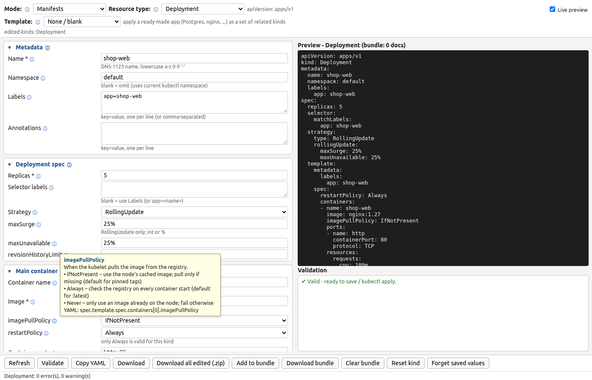

# Hover help and field reference

Every input, dropdown, checkbox, table column and section header has a small **ⓘ** icon next to
its label: in every Manifest kind, every Cluster config platform, the table-row dialogs (container
editor, tolerations, affinity rules, kind nodes, Kubespray hosts, EKS node groups, ...), the
template parameters, and the Mode / Resource type / Template selectors. Hover over it for about
0.4 s (or focus it with the keyboard, or tap / click it - tap again or Esc closes) to see what the
field is, what it does in Kubernetes or on the platform, the accepted format, an example, and the
YAML key path or config key / CLI flag it maps to. For dropdowns, each option gets a one-line
explanation (e.g. imagePullPolicy *Always / IfNotPresent / Never*). Tooltips use
`aria-describedby`, hide on scroll and stay inside the window.



The text lives in `field_docs.py`. At import, `manifest_gen` / `cluster_config_gen` copy it onto
each `Field` as `description`, `maps_to` and `option_help`, and `app_templates.Param` does the
same. `field_docs.tooltip(field)` renders the text, so you can read or test it headless:

```python
import manifest_gen as gen, field_docs
f = {f.key: f for _, fs in gen.SCHEMA["Deployment"] for f in fs}["image_pull_policy"]
print(field_docs.tooltip(f))
```

Kind-specific meanings are entered as `"Kind.key"` (e.g. `Service.selector`), table columns as
`"table.column"`, and cluster fields per platform. Paths are adjusted per kind (a CronJob's
container image maps to `spec.jobTemplate.spec.template.spec.containers[0].image`).
